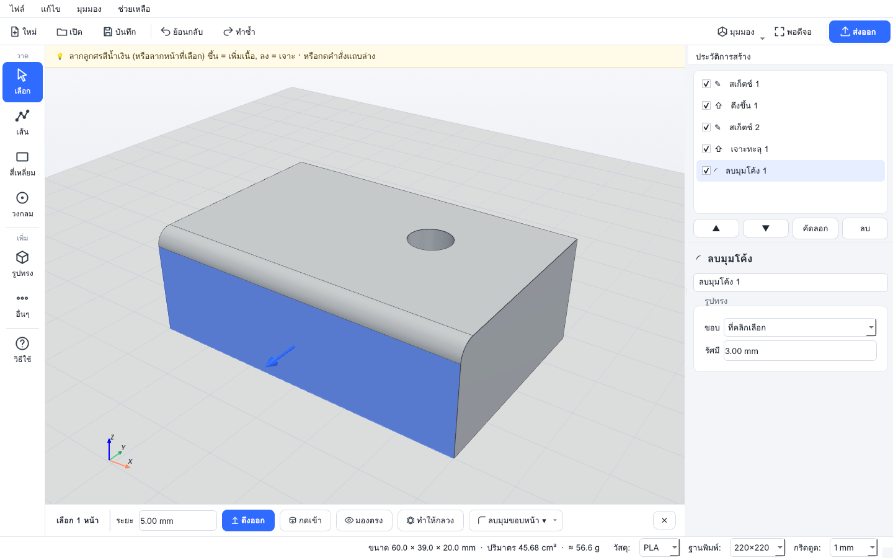
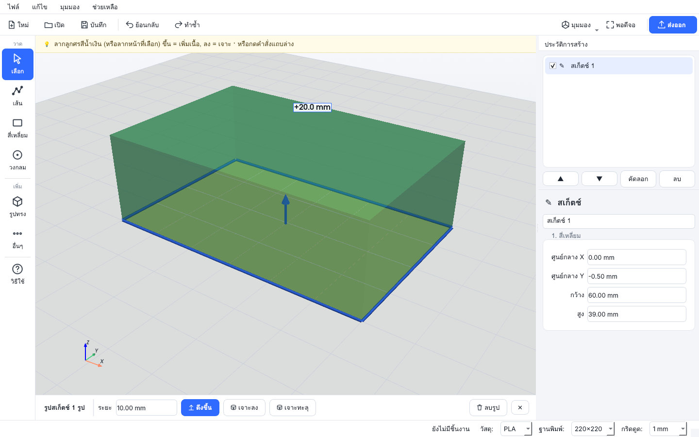

# 3D Maker

โปรแกรมออกแบบชิ้นงานสำหรับพิมพ์ 3D บน PC ใช้งานแบบ Shapr3D: **เลือกก่อน แล้วค่อยสั่ง**
วาดสเก็ตช์ลงบนหน้าของชิ้นงานได้ทันที แล้วลากลูกศรเพื่อดึงขึ้นหรือเจาะลง
ใช้แกน CAD จริง (OpenCascade ผ่าน build123d) ทุกขั้นตอนแก้ย้อนหลังได้



## ทำงานยังไง

| อยากทำ | วิธี |
|---|---|
| สร้างชิ้นงาน | กด **สี่เหลี่ยม** (R) → คลิก 2 จุดบนฐาน → **ลากลูกศรขึ้น** |
| เจาะรู | กด **วงกลม** (C) → คลิกบนหน้าชิ้นงาน → พิมพ์ขนาด เช่น `5` Enter → ลากลูกศร **ลง** หรือกด **เจาะทะลุ** |
| ดึง/กดหน้า | คลิกหน้า (เป็นสีน้ำเงิน) → ลากลูกศร |
| ลบมุม | คลิกขอบ (Shift+คลิกเลือกหลายขอบ) → **ลบมุมโค้ง / ลบมุมเฉียง** |
| ทำกล่องกลวง | คลิกหน้าบน → **ทำให้กลวง** |
| แก้ขนาดย้อนหลัง | คลิกขั้นตอนใน **ประวัติการสร้าง** ทางขวา แล้วแก้ตัวเลข |



- แถบสีเหลืองด้านบนบอกเสมอว่าขั้นต่อไปต้องทำอะไร แถบล่างแสดงคำสั่งที่ใช้กับสิ่งที่เลือกอยู่
- ระหว่างวาด พิมพ์ตัวเลขได้เลย (วงกลม = เส้นผ่านศูนย์กลาง, สี่เหลี่ยม = `กว้าง,ยาว`) แล้วกด Enter
- จุดจะดูดเข้ากริด 1 mm (เปลี่ยนได้ที่แถบล่างสุด) กด Shift ค้างเพื่อวางละเอียด 0.1 mm
- **เมาส์** (แบบ Shapr3D บน Windows): คลิกซ้าย = เลือก/วาด/ลาก · คลิกขวาค้างลาก = หมุน · ปุ่มกลาง = เลื่อน · ล้อ = ซูมตรงเคอร์เซอร์ · คลิกขวาเฉยๆ = ยกเลิก
- **ปากกา**: บนแท็บเล็ต/จอสัมผัสที่ใช้ Windows ปากกาทำงานเหมือนคลิกซ้าย ปุ่มข้างปากกา = คลิกขวา (หมุนมุมมอง)
- **คีย์ลัด**: V เลือก · L เส้น · R สี่เหลี่ยม · C วงกลม · Esc ยกเลิก · Del ลบ · Ctrl+Z / Ctrl+Y · F พอดีจอ · Ctrl+0..3 มุมมอง

ยังมีรูปทรงสำเร็จรูป (กล่อง ทรงกระบอก ทรงกลม กรวย โดนัท ข้อความ) และคำสั่งอื่นๆ (สะท้อน ย่อ/ขยาย นำเข้า STEP)
ในปุ่ม **รูปทรง** และ **อื่นๆ** ทางซ้าย ส่งออกเป็น **STL / 3MF / STEP** ได้ และมีแสดงขนาด ปริมาตร
และน้ำหนักโดยประมาณตามวัสดุ

## ติดตั้งและใช้งานบน Windows

1. ติดตั้ง [Python 3.11 ขึ้นไป](https://www.python.org/downloads/) และติ๊ก **Add Python to PATH**
2. ดาวน์โหลดโปรเจกต์นี้ (Code → Download ZIP) แล้วแตกไฟล์
3. ดับเบิลคลิก **`run.bat`** ครั้งแรกจะติดตั้งไลบรารีให้เอง ใช้เวลาไม่กี่นาที

### สร้างเป็นไฟล์ .exe

ดับเบิลคลิก `build_exe.bat` จะได้โปรแกรมที่ `dist\3DMaker\3DMaker.exe` คัดลอกทั้งโฟลเดอร์ไปใช้ที่เครื่องอื่นได้เลย ไม่ต้องลง Python
(โฟลเดอร์มีขนาดราว 1 GB+ เพราะรวมแกน CAD และ VTK ไว้ด้วย)

### รันแบบนักพัฒนา

```bash
python -m venv .venv
```

```bash
.venv\Scripts\pip install -r requirements-dev.txt
```

```bash
.venv\Scripts\python -m maker3d
```

```bash
.venv\Scripts\python -m pytest
```

## แบบใส่ตัวเลข

กดปุ่ม **รูปทรง** ทางซ้ายเพื่อเพิ่มกล่อง/ทรงกระบอก ฯลฯ แล้วกำหนดขนาด ตำแหน่ง การหมุน
และการทำซ้ำ (แถว/ตาราง/รอบวง) ที่แผงด้านขวา เลือก *การทำงาน* เป็น “ตัดออก” เพื่อใช้เป็นตัวคว้าน
เมื่อคลิกขั้นตอนในประวัติ ส่วนที่เพิ่มจะแสดงเป็นสีเขียวโปร่งใส ส่วนที่ตัดเป็นสีแดง

## โครงสร้างโค้ด

```
maker3d/
  model.py          รายการฟีเจอร์ พารามิเตอร์ การคำนวณรูปทรง ย้อนกลับ/บันทึก (ไม่ขึ้นกับ GUI)
  export.py         ส่งออก STL / 3MF / STEP
  gui/main_window.py หน้าต่างหลัก แถบเครื่องมือ รายการขั้นตอน
  gui/properties.py แผงคุณสมบัติที่สร้างจากพารามิเตอร์อัตโนมัติ
  gui/viewport.py   มุมมอง 3D: ชี้/คลิกเลือกหน้า ขอบ สเก็ตช์, วาดบนหน้า, ลากลูกศรดึง
  gui/icons.py      ไอคอนเส้น (SVG)
  gui/theme.py      ธีมสีสว่าง
tests/              ทดสอบส่วนคำนวณรูปทรงและการส่งออก
```

ถ้าจะเพิ่มรูปทรงใหม่ ให้เขียนฟังก์ชันสร้างรูปทรงแล้วลงทะเบียนด้วย `_reg(FeatureType(...))` ใน `model.py`
ปุ่มและแผงคุณสมบัติจะถูกสร้างให้อัตโนมัติ (เพิ่ม id ใน `BODY_BUTTONS` / `MODIFY_BUTTONS` ใน `main_window.py` ด้วย)

## แผนต่อไป

- เส้นโค้ง/ส่วนโค้ง และการตัดกันของรูปในสเก็ตช์ (region)
- ย้าย/หมุนชิ้นงานด้วยลูกศรในมุมมอง 3D
- รองรับท่าทางนิ้วบนจอสัมผัส (หมุน/ซูมด้วยสองนิ้ว)
