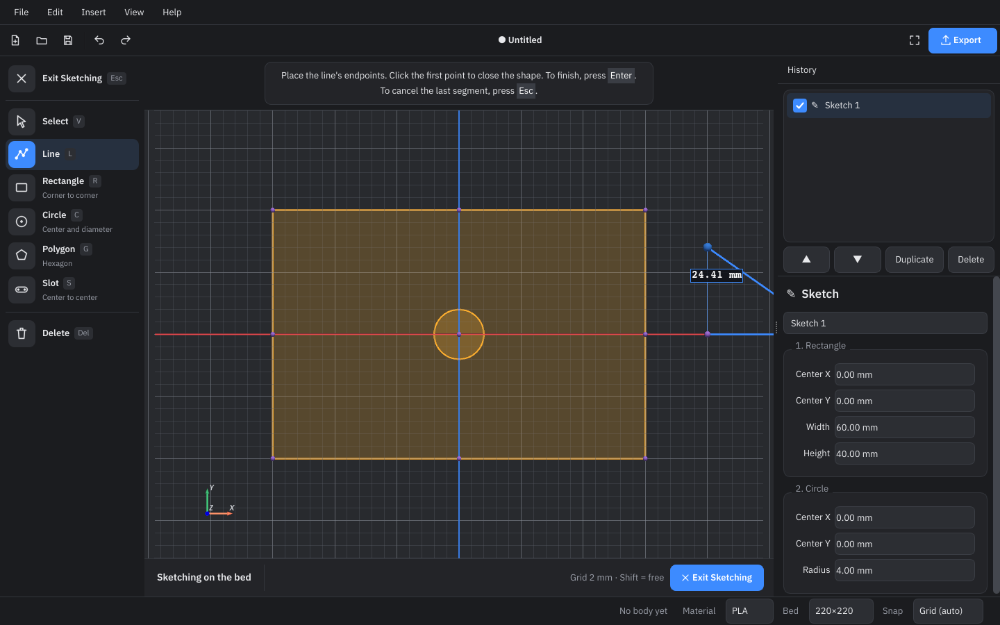

# 3D Maker

โปรแกรมออกแบบชิ้นงานสำหรับพิมพ์ 3D บน PC ใช้งานแบบ Shapr3D: **เลือกก่อน แล้วค่อยสั่ง**
วาดสเก็ตช์ลงบนหน้าของชิ้นงานได้ทันที แล้วลากลูกศรเพื่อดึงขึ้นหรือเจาะลง
ใช้แกน CAD จริง (OpenCascade ผ่าน build123d) ทุกขั้นตอนแก้ย้อนหลังได้




## ทำงานยังไง

หน้าจอเป็นภาษาอังกฤษ มี 2 โหมดแบบ Shapr3D

**Modeling**: คลิกเลือกหน้า ขอบ หรือรูปสเก็ตช์ แล้วลากลูกศรสีน้ำเงินเพื่อดึงขึ้นหรือเจาะ
**Sketching**: **ดับเบิลคลิกที่หน้าไหนของชิ้นงานก็ได้** (หรือที่ฐาน) กล้องจะหมุนให้หน้านั้นหันตรงมา
มีตารางขึ้น แล้ววาดด้วยเมาส์ได้เลย

| อยากทำ | วิธี |
|---|---|
| สร้างชิ้นงาน | ดับเบิลคลิกที่ฐาน → `R` Rectangle คลิก 2 มุม → `Esc` `Esc` → ลากลูกศรขึ้น |
| เจาะรู | ดับเบิลคลิกหน้าชิ้นงาน → `C` Circle → คลิกจุดกลาง → พิมพ์ `5` Enter → `Esc` `Esc` → **Cut Through** หรือลากลูกศรลง |
| วาดรูปอิสระ | `L` Line คลิกทีละจุด คลิกจุดแรกเพื่อปิดรูป (Enter = จบเป็นเส้นเปิด, Esc = ลบเส้นล่าสุด) |
| รูปหลายเหลี่ยม / ช่องยาว | `G` Polygon (ตั้งจำนวนด้านที่แถบล่าง) · `S` Slot (จุดศูนย์กลาง 2 ปลาย แล้วความกว้าง) |
| ดึง/กดหน้า | คลิกหน้า → ลากลูกศร |
| ลบมุม | คลิกขอบ (Shift+คลิกเพิ่ม) → **Fillet / Chamfer** |
| ทำกล่องกลวง | คลิกหน้าบน → **Shell** |
| แก้ขนาดย้อนหลัง | คลิกขั้นตอนใน **History** ทางขวา แล้วแก้ตัวเลข |


**การดูดของเมาส์ตอนวาด**: ดูดเข้ามุม จุดกึ่งกลาง และจุดศูนย์กลาง (จุดสีม่วง) · ดูดเข้าเส้นและแนวตั้ง/แนวนอน
ที่ตรงกับจุดอื่น (เส้นไกด์สีน้ำเงิน) · ดูดเข้าตาราง (ขนาดช่องปรับตามการซูม) · กด Shift ค้างเพื่อวางอิสระ
ระหว่างวาด **พิมพ์ตัวเลขได้เลย** แล้วกด Enter (เส้น = ความยาว, วงกลม = เส้นผ่านศูนย์กลาง, สี่เหลี่ยม = `กว้าง,ยาว`)

**เมาส์**: คลิกซ้าย = เลือก/วาด/ลาก · คลิกขวาค้างลาก = หมุน (แกน Z ตั้งตรงเสมอ) · ปุ่มกลาง = เลื่อน ·
ล้อ = ซูมตรงเคอร์เซอร์ · คลิกขวาเฉยๆ = ยกเลิก · ปากกาบน Windows ใช้แทนเมาส์ซ้ายได้ ปุ่มข้างปากกา = หมุน
**คีย์ลัด**: V L R C G S เครื่องมือ · K Sketch · Esc ย้อนกลับ/ออก · Del ลบ · Ctrl+Z / Ctrl+Y · F พอดีจอ

มีรูปทรงสำเร็จรูป (Box, Cylinder, Sphere, Cone, Torus, Text) ในเมนู **Insert** และคำสั่งอื่น
(Hole, Mirror, Scale, Import STEP) ใน **Tools** ส่งออก **STL / 3MF / STEP** ได้ และแสดงขนาด ปริมาตร
น้ำหนักโดยประมาณตามวัสดุ

## ติดตั้งและใช้งานบน Windows

1. ติดตั้ง [Python 3.11 ขึ้นไป](https://www.python.org/downloads/) และติ๊ก **Add Python to PATH**
2. ดาวน์โหลดโปรเจกต์นี้ (Code → Download ZIP) แล้วแตกไฟล์
3. ดับเบิลคลิก **`run.bat`** ครั้งแรกจะติดตั้งไลบรารีให้เอง ใช้เวลาไม่กี่นาที

### สร้างเป็นไฟล์ .exe

ดับเบิลคลิก `build_exe.bat` จะได้โปรแกรมที่ `dist\3DMaker\3DMaker.exe` คัดลอกทั้งโฟลเดอร์ไปใช้ที่เครื่องอื่นได้เลย ไม่ต้องลง Python
(โฟลเดอร์มีขนาดราว 1 GB+ เพราะรวมแกน CAD และ VTK ไว้ด้วย)

### รันแบบนักพัฒนา

```bash
python -m venv .venv
```

```bash
.venv\Scripts\pip install -r requirements-dev.txt
```

```bash
.venv\Scripts\python -m maker3d
```

```bash
.venv\Scripts\python -m pytest
```

## แบบใส่ตัวเลข

กด **Insert** ทางซ้ายเพื่อเพิ่ม Box / Cylinder ฯลฯ แล้วกำหนดขนาด ตำแหน่ง การหมุน
และ Pattern (แถว/ตาราง/รอบวง) ที่แผงด้านขวา ตั้ง *Operation* เป็น Cut เพื่อใช้เป็นตัวคว้าน
เมื่อคลิกขั้นตอนในประวัติ ส่วนที่เพิ่มจะแสดงเป็นสีเขียวโปร่งใส ส่วนที่ตัดเป็นสีแดง

## ถ้าใช้งานแล้วมีปัญหา

ข้อผิดพลาดทุกอย่างถูกบันทึกไว้ที่ `C:\Users\<ชื่อผู้ใช้>\.3dmaker\3dmaker.log`
(เปิดได้จากเมนู Help → Open Error Log Folder) ส่งไฟล์นี้พร้อมภาพหน้าจอมาเพื่อช่วยแก้ไข

## สกิลสำหรับ Claude Code

โฟลเดอร์ `.claude/skills` มีสกิลที่ Claude ใช้เมื่อแก้หน้าตา/การใช้งานของโปรแกรมนี้

- `cad-ux` — กฎ UX ของ 3D Maker (โหมด Modeling/Sketching, การดูด, เมาส์แบบ Shapr3D, สี, ข้อความภาษาอังกฤษ) และขั้นตอนทดสอบด้วยเมาส์จริง
- `frontend-design` — แนวทางออกแบบหน้าตา (จาก anthropics/skills, Apache-2.0)
- `web-design-guidelines` — รายการตรวจ UI (จาก vercel-labs/agent-skills, MIT)

ทดสอบ UI ด้วยเหตุการณ์เมาส์/คีย์บอร์ดจริง: `xvfb-run -a python tools/ui_e2e.py`
(จำลองจอขยาย 150%: `QT_SCALE_FACTOR=1.5 xvfb-run -a python tools/ui_e2e.py`)

## โครงสร้างโค้ด

```
maker3d/
  model.py          รายการฟีเจอร์ พารามิเตอร์ การคำนวณรูปทรง ย้อนกลับ/บันทึก (ไม่ขึ้นกับ GUI)
  export.py         ส่งออก STL / 3MF / STEP
  gui/main_window.py หน้าต่างหลัก แถบเครื่องมือ รายการขั้นตอน
  gui/properties.py แผงคุณสมบัติที่สร้างจากพารามิเตอร์อัตโนมัติ
  gui/viewport.py   มุมมอง 3D: ชี้/คลิกเลือกหน้า ขอบ สเก็ตช์, วาดบนหน้า, ลากลูกศรดึง
  gui/icons.py      ไอคอนเส้น (SVG)
  gui/theme.py      โทเคนสี ฟอนต์ และสไตล์ชีต
  gui/fonts/        IBM Plex Sans Thai (OFL)
tests/              ทดสอบส่วนคำนวณรูปทรงและการส่งออก
```

ถ้าจะเพิ่มรูปทรงใหม่ ให้เขียนฟังก์ชันสร้างรูปทรงแล้วลงทะเบียนด้วย `_reg(FeatureType(...))` ใน `model.py`
ปุ่มและแผงคุณสมบัติจะถูกสร้างให้อัตโนมัติ (เพิ่ม id ใน `BODY_BUTTONS` / `MODIFY_BUTTONS` ใน `main_window.py` ด้วย)

## แผนต่อไป

- เส้นโค้ง/ส่วนโค้ง และการตัดกันของรูปในสเก็ตช์ (region)
- ย้าย/หมุนชิ้นงานด้วยลูกศรในมุมมอง 3D
- รองรับท่าทางนิ้วบนจอสัมผัส (หมุน/ซูมด้วยสองนิ้ว)
